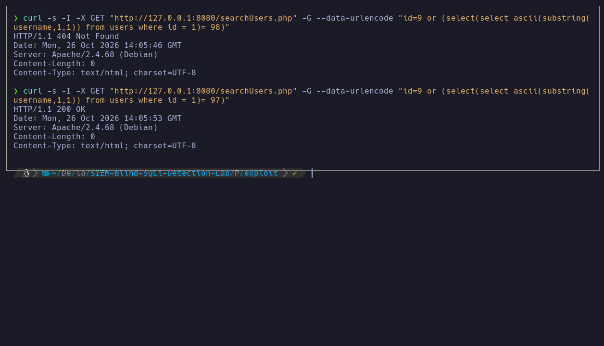

## BLIND Boolean based SQLI

First of all, we will start with the reconnaissance phase. In my case, let's assume that the victim machine, which in this case would be the server 127.0.0.1, has port 8080 open, from which I will realize that it has a web page through that port. So once inside the web, I would start auditing the web page searchUsers.php.

As I have defined in my PHP code in searchUsers.php, I cannot see anything, but if I intercept the requests with BurpSuite or view the response headers with *curl*, I can obtain a 200 OK status code if a user id exists at the time of making the query on the PHP page, but if I put an id that does not exist, it returns a 404 status code.

Since this first attack is a boolean-based SQLi, first I make comparisons of the returned status codes. First I used BurpSuite; now with Linux commands I will see the status codes. Since I know it returned a 404 error when the id does not exist, then I can apply a logic gate with OR first. So I make a comparison "id=9 OR 1=1". In this case, identifier number 9 does not exist, so the next logic gate where 1=1 is triggered, and it is correct, therefore it returns a 200 OK.

In my case I created a sanitization that is usually common, and it is the use of **mysql_real_escape_string()**. This function escapes quotes and certain special characters, but this sanitization can be bypassed. In my case I am going to bypass it using decimals, basically making use of ASCII.

So if I apply for example "id=9 or ()" inside those parentheses I can apply a *nested query*. In my case what I would be doing is "id=9" which is incorrect OR "97=97" which is True in decimal. But of course in this case I am assuming there is a users table with columns username, password or whatever corresponds.

Let's say I want to find out the name of the user we are filtering, then I would use the substring(username,1,1) function and make an equivalence with the id, where this would be "id=1". Then since the name of the first user is admin, the first letter that substring takes compared with the id would be True, but assuming we don't know it, we would have to apply brute force. Remember, since we are using ASCII, instead of the letter "a" it will be "97", its decimal equivalent.

So in this screenshot you can see two status codes, both 404 and 200. When the decimal comparison matches, then it gives me a 200, but if I put for example another decimal, it gives me a 404.

Therefore right now I have a potential blind way, without seeing any output, to be able to intuit through conditionals when the character is correct or when it is not, so now is when I will start with Python scripting, in which I will automate the attack and obtain both the users and passwords.
