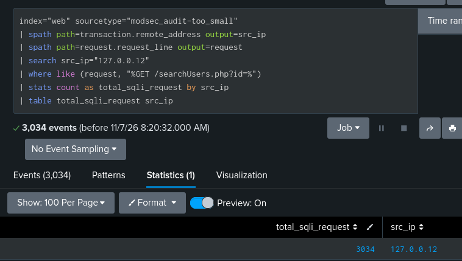
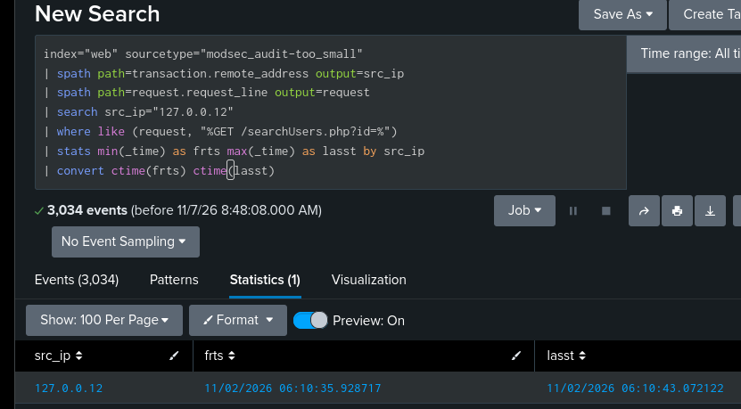
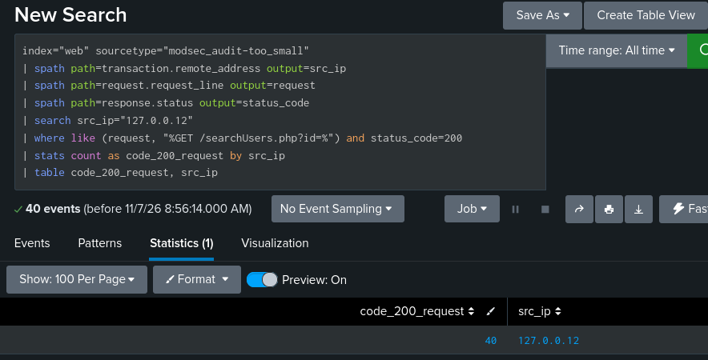
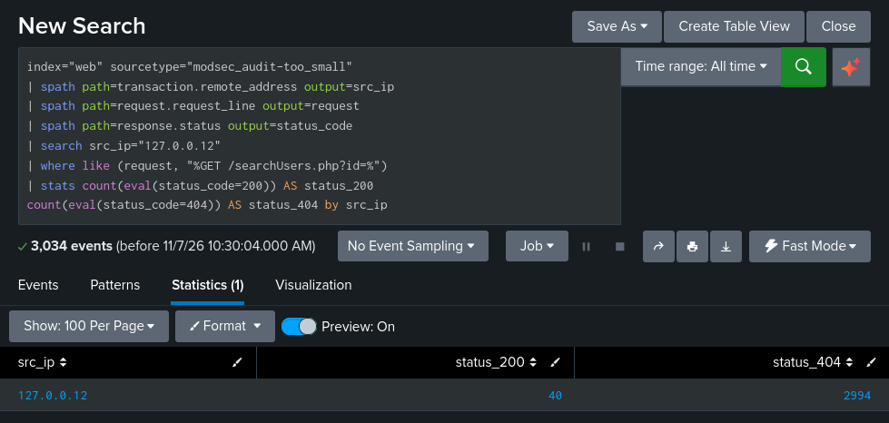
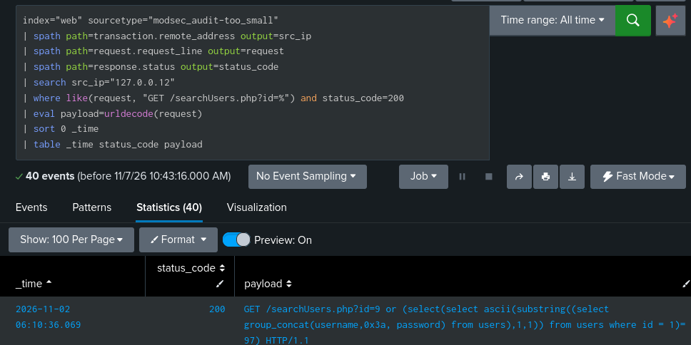
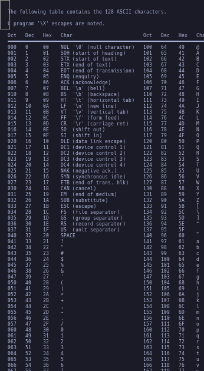
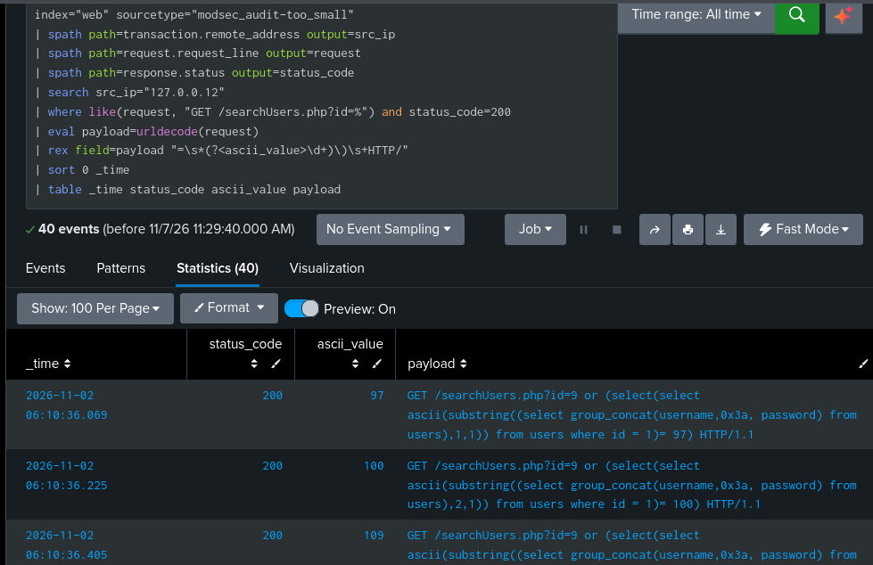
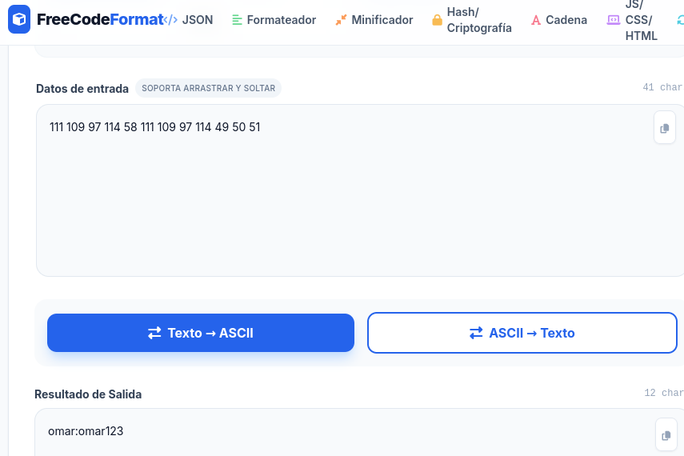

# Blind SQL Injection — SOC Analyst Investigation Lab

Investigating suspected blind SQL injection against a PHP application backed by MariaDB, using **Splunk** for log analysis, **ModSecurity** for initial detection, and **Jira** for case documentation and simulated Tier 2 escalation.

This project focuses on the **SOC Tier 1 investigation workflow**: validating an alert, reconstructing suspicious activity, assessing potential impact, and escalating with actionable evidence.

## Lab Components

| Component | Role |
|---|---|
| Splunk (SIEM) | Centralized log analysis and investigation |
| ModSecurity (WAF)| Initial web attack detection in DetectionOnly mode |
| Suricata (IDS/IPS)| Network monitoring and detection coverage assessment |
| PHP application (Backend connected with ddbb)| Target web application |
| MariaDB SQL (Data Base) | Application database |
| Python script (Automated attack from pentester)| Controlled attack simulation |
| Jira (Ticket software)| Case documentation and simulated escalation |

## Scenario

A Python script sends SQL injection requests to a deliberately vulnerable PHP application in a controlled lab environment.

ModSecurity operates in **DetectionOnly** mode: it identifies suspicious requests without blocking them. Its events are ingested into Splunk, where the investigation begins.

Suricata is also deployed but does not initially generate alerts for the tested attack. The investigation considers sensor visibility and detection coverage before interpreting this absence of alerts.

## Investigation Objectives

- Validate the initial ModSecurity detection against the underlying request data.
- Identify the targeted endpoint, parameter, and observed source.
- Reconstruct the request timeline and examine response patterns.
- Assess whether the evidence supports an SQL injection attempt, successful exploitation, or data extraction.
- Document findings, uncertainty, and investigation limits in Jira.
- Perform a simulated Tier 2 escalation when the evidence or risk warrants further investigation.

## Scope

A later improvement phase will introduce additional Suricata rules and compare detection results against the initial configuration.

## 1. Initial Alert and Triage

It's a normal day and while reviewing events, I see one from ModSecurity, and I ask myself a couple of questions before continuing: What triggered the detection? Does the detection make sense or is it a false positive? What system does it affect? And what impact does it present for the company? Taking a superficial look, I start seeing all the detection parameters.


I begin the part of filtering the most relevant information, for example I take the detection identifier.


### Initial Evidence

At this point I apply a filter to capture the relevant parameters from the log `/var/log/apache2/modsec_audit.log`. With all these parameters, my conclusion is that although I cannot know whether the attack was successful, by analyzing the request URI I can see it is an SQLi attack. I still cannot determine which type, but from its queries it is evident that the objective of the attack is to extract credentials from the database. Therefore, with the data I have available, I create a ticket in Jira and escalate it to Tier 2 immediately, since this attack is critical and recent, and could breach the confidentiality leg of the CIA triad. So I raise the ticket to SOC Tier 2 immediately and in parallel I will work on this incident by applying the playbook, but first I submit the ticket to Jira.


```
ModSecurity detected an SQL injection attempt against the id parameter of GET /searchUsers.php on web_lab.

The request originated from 127.0.0.12:50511 and targeted 127.0.0.1:8080/searchUsers.php. The payload contained nested SELECT statements, GROUP_CONCAT, SUBSTRING and ASCII functions, attempting to test a character from concatenated username and password values in the users table. This is consistent with a boolean-based blind SQL injection attempt.

Observed evidence:

First attack: 11/2/26 6:10:35.000 AM

Last attack: 11/2/26 6:10:43.000 AM

Transaction ID: auhvr_8Ubm0aUjNNem_3fQAAAAE.

SQLi rules triggered: 942100 and 942360.

SQLi anomaly score: 10 and total inbound anomaly score: 13.

ModSecurity engine mode: DETECTION_ONLY.

HTTP response: 404, with Content-Length: 0.

User-Agent: python-requests/2.32.3.

Initial assessment:
The request contains a clear SQL injection payload. ModSecurity detected the attempt but did not block it because it was operating in detection-only mode. The HTTP 404 response does not establish whether the injected SQL executed successfully.

Successful exploitation and data extraction have not been confirmed. The scope and number of distinct malicious requests are still under investigation.

Next steps:
Review related requests and responses, correlate available application and database logs, and assess whether response differences indicate successful boolean-based inference.
```


I start by doing a quick filtering based on the suspicious IP `127.0.0.12`, where I count all its requests containing a general part of the payload. By applying the following filter to obtain the JSON parameters from the mod_security logs, I get this data.



Filtering based on the IP and the query with the payload, the first attack began at `127.0.0.12	2026-11-02 06:10:35.928` and for now ended at `127.0.0.12	2026-11-02 06:10:43.072`. With these data we can conclude that the attack lasted `7.144 seconds`.



We still cannot conclude whether there was credential theft. In the next step I will filter by status 200 and 404, since by observing the payload I can deduce that it is a boolean-based SQLi attack, but as I said before, I still cannot determine whether there was credential theft.

## Validation

By applying another filter based on the status code, the suspicious IP, and part of the payload, I discovered that the attacker made `3034` brute-force requests, of which `2994` responses returned a 404 and `40` were 200 OK.





At this point I notice a suspicious pattern in the probability of the 200 status code responses. Right now, with the data I have in Jira, I change the escalation to SOC Tier 2 from `MEDIUM` to `High risk`, since we cannot afford any more time. In parallel I am going to URL-decode the payload and apply reverse engineering. First I will apply a SPL filter with the condition that shows me the queries containing a `200` status code response from the web server side.



Analyzing the payload I observe the use of `:` in hexadecimal such as `0x3a` and that it uses the ASCII method together with the `substring` method, where it takes only the first letter of users for example, converts it to ASCII code and compares it with another letter that is also in ASCII code. In this case it starts with `97`=`a`; 97 in ASCII code represents the letter "a".



As can be seen in the image, since `97 = a` and the status code is 200, it can be inferred that the attack obtained the first character. Now I will apply the same to the rest to see if it completes a word; likewise, passwords should not be stored in plain text, but at minimum encrypted in a hash.





By applying the filter on the payload, isolating the ASCII code value and decoding it to plain text as can be seen, I firmly state that the attacker achieved a credential theft from the SQL database.

With all this data collected, I state that a `blind boolean based SQLi` attack was received. I reviewed different Apache2, SQL, ModSecurity, and Suricata logs, in which I could observe that the attacker's IP `127.0.0.12` ceased its attack once it had obtained all the credentials from the `users` table in MySQL. Regarding the `CIA triad`, this decisively breaches the `confidentiality` component.

## Recommended 

The following actions are proposed based on the investigation findings. They remain pending unless implementation and validation evidence is documented.

| Priority | Recommendation | Responsible team |
|---|---|---|
| Immediate | Notify the incident lead that both PHP application administrator and MariaDB administrator credentials were exposed. | SOC Tier 2 / Incident Response |
| Immediate | Rotate the exposed administrative credentials through a trusted management channel. Coordinate any dependent application configuration updates and verify service operation. | Database Administration / Application team |
| Immediate | Revoke PHP administrator sessions and tokens. Review and terminate unauthorized active database connections; password rotation alone must not be assumed to terminate existing sessions. | Application team / Database Administration |
| Immediate | Preserve available database, application, authentication, and web server logs before making changes that could destroy evidence. Record containment actions and timestamps. | Incident Response / SOC |
| High | Investigate privileged account activity across all source IPs, including new accounts, privilege changes, database modifications, and changes to application files or configuration. | SOC Tier 2 / Incident Response |
