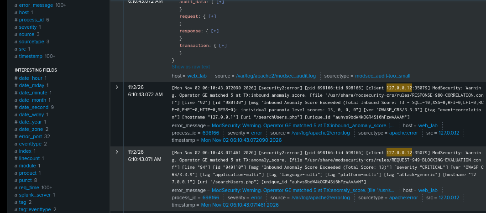
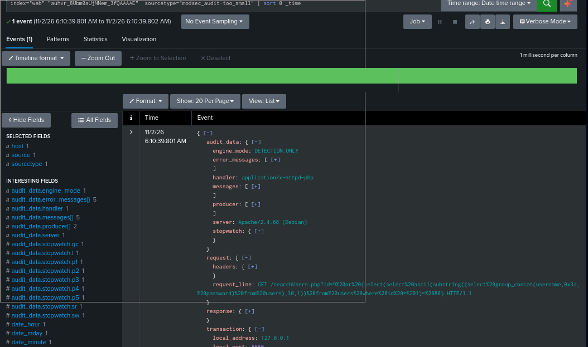
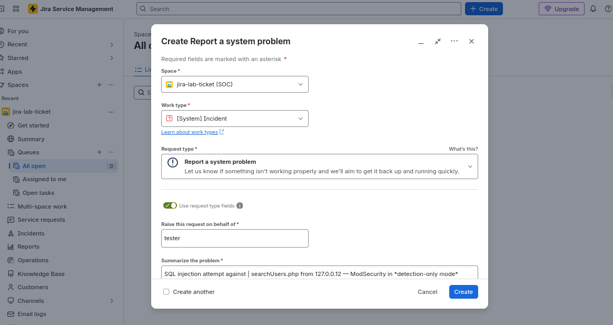
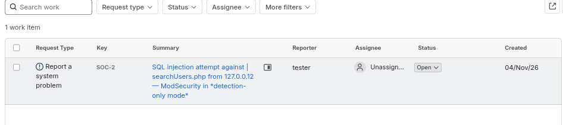

# Blind SQL Injection — SOC Analyst Investigation Lab

Investigating suspected blind SQL injection against a PHP application backed by MariaDB, using **Splunk** for log analysis, **ModSecurity** for initial detection, and **Jira** for case documentation and simulated Tier 2 escalation.

This project focuses on the **SOC Tier 1 investigation workflow**: validating an alert, reconstructing suspicious activity, assessing potential impact, and escalating with actionable evidence.

## Lab Components

| Component | Role |
|---|---|
| Splunk (SIEM) | Centralized log analysis and investigation |
| ModSecurity (WAF)| Initial web attack detection in DetectionOnly mode |
| Suricata (IDS/IPS)| Network monitoring and detection coverage assessment |
| PHP application (Backend connected with ddbb)| Target web application |
| MariaDB SQL (Data Base) | Application database |
| Python script (Automated attack from pentester)| Controlled attack simulation |
| Jira (Ticket software)| Case documentation and simulated escalation |

## Scenario

A Python script sends SQL injection requests to a deliberately vulnerable PHP application in a controlled lab environment.

ModSecurity operates in **DetectionOnly** mode: it identifies suspicious requests without blocking them. Its events are ingested into Splunk, where the investigation begins.

Suricata is also deployed but does not initially generate alerts for the tested attack. The investigation considers sensor visibility and detection coverage before interpreting this absence of alerts.

## Investigation Objectives

- Validate the initial ModSecurity detection against the underlying request data.
- Identify the targeted endpoint, parameter, and observed source.
- Reconstruct the request timeline and examine response patterns.
- Assess whether the evidence supports an SQL injection attempt, successful exploitation, or data extraction.
- Document findings, uncertainty, and investigation limits in Jira.
- Perform a simulated Tier 2 escalation when the evidence or risk warrants further investigation.

## Scope

A later improvement phase will introduce additional Suricata rules and compare detection results against the initial configuration.

## 1. Initial Alert and Triage

It's a normal day and while reviewing events, I see one from ModSecurity, and I ask myself a couple of questions before continuing: What triggered the detection? Does the detection make sense or is it a false positive? What system does it affect? And what impact does it present for the company? Taking a superficial look, I start seeing all the detection parameters.



I begin the part of filtering the most relevant information, for example I take the detection identifier.



### Initial Evidence

At this point I apply a filter to capture the relevant parameters from the log `/var/log/apache2/modsec_audit.log`. With all these parameters, my conclusion is that although I cannot know whether the attack was successful, by analyzing the request URI I can see it is an SQLi attack. I still cannot determine which type, but from its queries it is evident that the objective of the attack is to extract credentials from the database. Therefore, with the data I have available, I create a ticket in Jira and escalate it to Tier 2 immediately, since this attack is critical and recent, and could breach the confidentiality leg of the CIA triad. So I raise the ticket to SOC Tier 2 immediately and in parallel I will work on this incident by applying the playbook, but first I submit the ticket to Jira.



```
ModSecurity detected an SQL injection attempt against the id parameter of GET /searchUsers.php on web_lab.

The request originated from 127.0.0.12:50511 and targeted 127.0.0.1:8080/searchUsers.php. The payload contained nested SELECT statements, GROUP_CONCAT, SUBSTRING and ASCII functions, attempting to test a character from concatenated username and password values in the users table. This is consistent with a boolean-based blind SQL injection attempt.

Observed evidence:

First attack: 11/2/26 6:10:35.000 AM

Last attack: 11/2/26 6:10:43.000 AM

Transaction ID: auhvr_8Ubm0aUjNNem_3fQAAAAE.

SQLi rules triggered: 942100 and 942360.

SQLi anomaly score: 10 and total inbound anomaly score: 13.

ModSecurity engine mode: DETECTION_ONLY.

HTTP response: 404, with Content-Length: 0.

User-Agent: python-requests/2.32.3.

Initial assessment:
The request contains a clear SQL injection payload. ModSecurity detected the attempt but did not block it because it was operating in detection-only mode. The HTTP 404 response does not establish whether the injected SQL executed successfully.

Successful exploitation and data extraction have not been confirmed. The scope and number of distinct malicious requests are still under investigation.

Next steps:
Review related requests and responses, correlate available application and database logs, and assess whether response differences indicate successful boolean-based inference.
```


